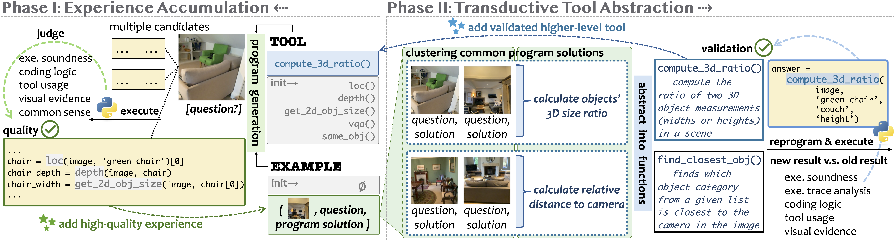

<br>
<div align="center">
<h1>Transductive Visual Programming (TVP)</h1>
<h3>Evolving Tool Libraries from Experience for Spatial Reasoning</h3>

[](https://transductive-visualprogram.github.io/)
[](https://arxiv.org/abs/2512.20934)

</div>

---

**TVP** is a visual programming framework that builds reusable tools from its own problem-solving experience. TVP implements a closed-loop paradigm via two interconnected libraries: an <b>Example Library</b> that accumulates program solutions as experience, and a <b>Tool Library</b> that maintains functions abstracted from these programs. The dual-libraries enable the circular <b>program-tool-program</b> cycle: solving problems generates experience, experience guides tool creation, and newly created tools improve future problem-solving.

<p align="center">
  
</p>

---

<a name="updates"></a>

## 📢 Updates

- **[2026-01-06]** Check out our [X thread](https://x.com/ShengguangWu/status/2008713289568596267)
- **[2025-12-24]** Code released.
- **[2025-12-23]** Paper available on [arXiv](https://arxiv.org/abs/2512.20934).

---

## 🚀 Quick Start

### Environment Setup

This checkout uses Python 3.10 and a project-local `.venv` managed by uv.
PyTorch 2.5.1, torchvision 0.20.1, torchaudio 2.5.1 and xformers 0.0.28.post3
are installed from the official CUDA 12.4 wheel index configured in
`pyproject.toml`. Other packages use the configured Aliyun PyPI index.

Prepare the local source dependencies before syncing a fresh checkout:

```bash
git clone https://github.com/IDEA-Research/GroundingDINO.git models/GroundingDINO
git clone https://github.com/lpiccinelli-eth/UniDepth.git models/UniDepth
```

Install the locked environment with the GPU hidden from build processes:

```bash
mkdir -p .setup/tmp
TMPDIR="$PWD/.setup/tmp" CUDA_VISIBLE_DEVICES="" \
CUDA_HOME=/usr/local/cuda-12.4 TORCH_CUDA_ARCH_LIST=8.9 MAX_JOBS=2 \
uv sync --locked
```

The CUDA 12.4 **runtime** is installed by uv from the PyTorch wheel dependencies.
The existing `/usr/local/cuda-12.4` toolkit is used only by GroundingDINO's normal
package build. The explicit architecture targets this host's RTX 4090 without
querying a GPU during compilation; build parallelism is limited to two jobs.
No third-party source patches or separate UniDepth compilation scripts are used.
`no-build-isolation-package = ["groundingdino"]` makes its build use the project's
installed PyTorch. Initial dependency registration used
`uv add --no-build-isolation --editable ./models/GroundingDINO ./models/UniDepth`.
The original `env_setup.sh` has been retired.

Installed source revisions:

- GroundingDINO: `856dde20aee659246248e20734ef9ba5214f5e44`
- UniDepth: `8d8cfe4c7ee15297099983607febf0d4f32eb3d6`

FlagEmbedding 1.3.3 requires transformers 4.44.2. PEFT 0.13.2 and
sentence-transformers 3.1.1 are pinned alongside that Transformers generation.
All resolved versions are recorded in `uv.lock`.

### Local Model Files

All model files are real files under this checkout, not symlinks to another
project or dependencies on an external model cache:

```text
models/checkpoints/
├── groundingdino/
│   ├── groundingdino_swint_ogc.pth
│   └── groundingdino_swinb_cogcoor.pth
├── bert-base-uncased/
├── unidepth-v2-vits14/
└── bge-large-en-v1.5/
```

On a fresh setup, copy the existing GroundingDINO files and download the
remaining models without loading them:

```bash
mkdir -p models/checkpoints/groundingdino
cp -n /home/guoxi/Projects/vla/grounded-sam2/Grounded-SAM-2/gdino_checkpoints/groundingdino_swint_ogc.pth models/checkpoints/groundingdino/
cp -n /home/guoxi/Projects/vla/grounded-sam2/Grounded-SAM-2/gdino_checkpoints/groundingdino_swinb_cogcoor.pth models/checkpoints/groundingdino/
uv run hf download google-bert/bert-base-uncased --local-dir models/checkpoints/bert-base-uncased --include model.safetensors config.json tokenizer.json tokenizer_config.json vocab.txt LICENSE README.md
uv run hf download lpiccinelli/unidepth-v2-vits14 --local-dir models/checkpoints/unidepth-v2-vits14 --include model.safetensors config.json README.md
uv run hf download BAAI/bge-large-en-v1.5 --local-dir models/checkpoints/bge-large-en-v1.5 --include model.safetensors '*.json' vocab.txt README.md
```

Download commands intentionally omit `--env-file .env`: the runtime environment
file disables network model downloads. These commands prepare files only; they
do not instantiate a model. Do not overwrite existing model files from an
unrelated setup. All resulting weights are ordinary local files.

GroundingDINO and UniDepth resolve checkpoints under `--models-path`.
`--embedding-model` defaults to `./models/checkpoints/bge-large-en-v1.5`.
BGE remains the original local embedding model, with the original retrieval
instruction, FP16 and normalization behavior. The optional UniDepth ViT-L
variant requires its own local `checkpoints/unidepth-v2-vitl14` directory;
only the default ViT-S variant is prepared here.

### Model Service Configuration

On first setup, copy `.env.example` to `.env` and keep `.env` untracked:

```bash
cp .env.example .env
```

`OPENAI_API_KEY` and `OPENAI_BASE_URL` configure the existing Qwen service.
Each role reads its own environment variable: `TVP_PROGRAM_MODEL`,
`TVP_JUDGE_MODEL`, `TVP_CLUSTER_MODEL`, `TVP_ABSTRACTION_MODEL`,
`TVP_DEDUPLICATION_MODEL`, `TVP_CORRECTNESS_MODEL`, `TVP_REWRITE_MODEL`,
`TVP_MERGE_MODEL`, and `TVP_VQA_MODEL`. The corresponding explicit CLI argument
wins over the environment value; each role defaults to `Qwen3.8-Flash-Next`.
All roles share the existing service URL and key.
The base URL is `http://10.1.110.29:30001/v1`; `EMPTY` is the placeholder for
the currently unauthenticated service. The former `api.key` file and
`--api-key-path` option are no longer used.

Run commands from the TVP root with `uv run --env-file .env`.
The environment file also enables Hugging Face offline mode so model loading
does not silently download files or substitute remote model IDs.

**Execution is currently paused:** do not run model-loading checks (including
CPU checks), GPU inference, service requests, or the examples below until the
user explicitly authorizes testing. Existing GPU services must remain untouched.
Installation and static checks do not establish that model inference works.

### Installation Status (2026-10-16)

The project environment, local editable dependencies and all default model files
are installed. `uv sync --locked`, `uv pip check`, Python AST syntax checks,
Ruff formatting checks, environment-key comparison, checkpoint copy comparison,
and downloaded-file metadata checks passed. No model-loading or inference tests
were run, including CPU tests, and no model-service test requests were sent.

Ruff reports five pre-existing findings (three broad exception handlers and two
unused unpacked values); comparison with the original files found no new lint
diagnostics. Pre-commit could not run because this repository has no hook
configuration. Adding a new gate was rejected by automatic approval review;
`.env` and `.env.example` keys were checked directly instead.

### Reproduction Development Checks (2026-10-16)

All 16 offline reproduction tests pass, including interrupted state promotion
and null-response failure behavior. `git diff --check` passes. Unrelated
formatting changes have been reverted; formatter compliance is not claimed.
Dependencies and project configuration were not changed by this reproduction
development. No real models or model services were exercised.

### Download Omni3D-Bench

[Omni3D-Bench](https://huggingface.co/datasets/dmarsili/Omni3D-Bench) contains 501 challenging 3D spatial reasoning questions on real-world indoor scenes. Download and prepare the dataset:

```bash
mkdir -p data
huggingface-cli download dmarsili/Omni3D-Bench --repo-type dataset --include "omni3d-bench.zip" --local-dir ./data
unzip ./data/omni3d-bench.zip -d ./data
rm -rf ./data/.cache ./data/omni3d-bench.zip
```

After setup, your data directory should look like:
```
data/
└── omni3d-bench/
    ├── images/
    │   └── ARKitScenes/
    │       └── Training/
    │           └── .../*.jpg
    └── annotations.json
```

---

## 🔬 Running TVP

### Toy Run (Quick Demo)

To quickly see how TVP works, run a toy subset on 10 datapoints with relaxed thresholds. This demonstrates all pipeline components—example accumulation, tool abstraction, and deduplication—in a short run:

```bash
set -o pipefail
mkdir -p output/tvp_toy_subset
uv run --env-file .env python main.py \
    --resume tvp_toy_subset \
    --results-path ./output \
    --num-questions 10 \
    --num-iterations 2 \
    --programs-per-question 2 \
    --quality-threshold 8.0 \
    --similarity-threshold 0.5 \
    --abstraction-interval 1 \
    --clustering-threshold 0.5 \
    --min-cluster-size 2 \
    --abstraction-potential-threshold 5.0 \
    --min-correctness-rate 0.5 \
    --deduplication-interval 1 \
    --deduplication-threshold 0.6 \
    --save-exe-trace 2>&1 | tee "output/tvp_toy_subset/run_$(date +%Y%m%d_%H%M%S_%N).log"
```

Results will be saved to `output/tvp_toy_subset/`. The `--save-exe-trace` flag generates HTML visualizations of each program execution for inspection.

### Complete Run

To experiment on the full Omni3D-Bench dataset:

```bash
set -o pipefail
mkdir -p output/tvp_omni3d_full
uv run --env-file .env python main.py \
    --resume tvp_omni3d_full \
    --results-path ./output \
    --num-questions -1 \
    --num-iterations 3 \
    --programs-per-question 4 \
    --random-seed 42 --reorder-questions-per-iteration \
    --max-retrieved-examples 3 \
    --quality-threshold 8.5 \
    --similarity-threshold 0.8 \
    --abstraction-interval 1 \
    --clustering-threshold 0.8 \
    --min-cluster-size 4 \
    --abstraction-potential-threshold 9.0 \
    --min-correctness-rate 0.85 \
    --deduplication-interval 1 \
    --deduplication-threshold 0.95 2>&1 | tee "output/tvp_omni3d_full/run_$(date +%Y%m%d_%H%M%S_%N).log"
```

**Estimated cost:** ~$80 per iteration with GPT-4o + o4-mini.

See `uv run --env-file .env python main.py --help` for all available configuration options.

### 🔄 Resumability

Resume with the **original complete command**, including the data paths, model
arguments, thresholds, candidate count and run ID. The program does not restore
or lock all old parameters. Changing them may mix old completed answers with
new settings. `metadata.json` retains the first configuration; each startup logs
the actual configuration. Credentials are not written to experiment records.

Add `--stop-iteration 1 --stop-position 10` to stop inclusively after the tenth
question in the first saved order. On subsequent invocations, advance to
`--stop-iteration 1 --stop-position 20` or `--stop-iteration 2 --stop-position 10`.
Keep `--num-questions` and `--num-iterations` unchanged. Omitting both stop
arguments runs to the experiment end. A completed cutoff does not advance work.

`sampled_questions.json` holds the full selected collection. Each iteration's
order is saved under `state/iteration_<n>_order.json` and reused on resume.
Answer completion is recorded separately from library updates. The state
checkpoint advances after example updates, abstraction and deduplication;
published multi-file commits are finished before state is loaded on restart.
Only incomplete question or update-stage artifacts are rebuilt on retry.

All artifacts belong to `output/<run_id>/`: `iterations/`, `state/`,
`abstraction/`, `deduplication/`, `quality_reevaluation/`, `logs/`, `tmp/`, and
`eval/`. The entry derives `TMPDIR` and `tempfile.tempdir` before model imports;
this does not control uv's own startup. Structured logs append across starts.
The Bash examples capture stdout and stderr in a new timestamped log and use
`pipefail` to retain Python failure status.

Each LLM response has a JSON record with `content`, `finish_reason`, and `usage`
next to its existing text artifact; missing values are null. VQA records are
stored in the corresponding execution directory. Connection errors and request
timeouts stop the run after finite retries; ordinary functional failures keep
the original behavior. Pending parallel tasks are cancelled and in-flight tasks
finish before exit. Solving and validation share one visual-model instance,
with independent namespaces and cleared traces.

The main experiment uses 501 questions, 3 iterations and 4 candidates. Report
the third online iteration; no extra frozen-library test iteration is added.
Qwen replaces the paper's reasoning model. Per-iteration reshuffling is the
user's chosen protocol, not a detail established by the paper. Partial iterations
must be reported with both planned and completed counts.

Offline checks (no model loading or service requests):

```bash
CUDA_VISIBLE_DEVICES="" HF_HUB_OFFLINE=1 TRANSFORMERS_OFFLINE=1 \
uv run --no-sync python -m unittest test_reproduction -v
```

---

## 📈 Evaluation

Evaluation is a two-step process: (1) extract results from the TVP pipeline run, and (2) compute metrics.

### Step 1: Extract Results

After running TVP, extract solutions and associated metadata into a single JSON file:

```bash
uv run --env-file .env python eval/extract_results.py --run-id tvp_omni3d_full
```

This reads from `output/tvp_omni3d_full/` and writes `output/tvp_omni3d_full/eval/extracted_results.json`.

### Step 2: Compute Metrics

Evaluate metrics on the extracted results:

```bash
uv run --env-file .env python eval/eval_metrics.py --run-id tvp_omni3d_full
```

This computes per-iteration metrics and saves detailed results to `output/tvp_omni3d_full/eval/metrics/`.

### Metrics

The evaluation reports the following metrics by question type:

| Question Type | Metric |
|---------------|--------|
| **Yes/No** | Accuracy |
| **Multiple Choice** | Accuracy |
| **Count** | Accuracy (exact match) |
| **Float** | Accuracy (±10% relative error) |
| **Float** | MRA (Mean Relative Accuracy across thresholds 5%–50%) |
| **Overall** | Accuracy (using Float Accuracy ±10%) |

Results are saved as both a summary JSON and per-iteration CSV files. Only completed questions enter metrics, including completed failures. Not-started and incomplete questions remain explicitly marked in extracted results. Empty categories report null / N/A; partial iterations include planned and completed counts.

---

## Citation

If you find TVP useful, please consider citing our paper:

```bibtex
@article{wu2025transductive,
  title={Transductive Visual Programming: Evolving Tool Libraries from Experience for Spatial Reasoning},
  author={Wu, Shengguang and Wang, Xiaohan and Zhang, Yuhui and Zhu, Hao and Yeung-Levy, Serena},
  journal={arXiv preprint arXiv:2512.20934},
  year={2025}
}
```

---

## Acknowledgments

TVP builds upon several open-source projects. We thank the authors for their codebase: [VADAR](https://github.com/damianomarsili/VADAR), [GroundingDINO](https://github.com/IDEA-Research/GroundingDINO), [UniDepth](https://github.com/lpiccinelli-eth/UniDepth), [FlagEmbedding](https://github.com/FlagOpen/FlagEmbedding).
